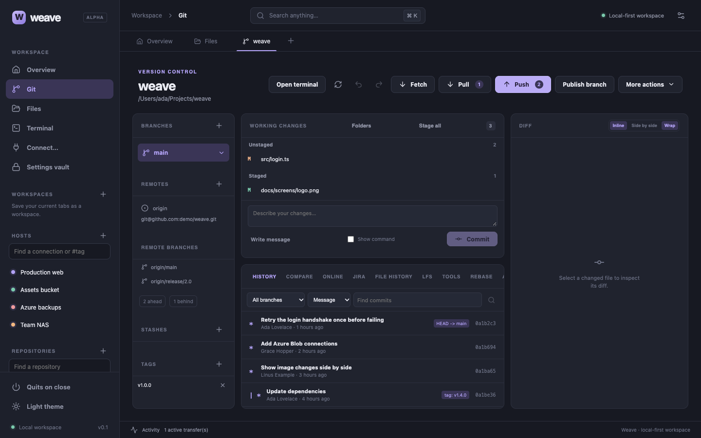

# Weave

Weave is a desktop app for Git, file transfers and terminals. It runs on macOS, Windows and Linux, and it keeps your hosts, history and settings on your own computer.

It is an alpha. It has not been through an outside security review, and some features have only been tested against local test servers (see [Current limits](#current-limits)).

Website: https://farishrvat.github.io/weave/



## What it does

**Git.** Open, clone and create repositories. Stage files, hunks or single lines, commit, amend, fetch, pull, push and publish branches. There is a graph, blame, file history, an interactive rebase planner, worktrees, Gitflow, submodules, sparse checkout, Git LFS, stashes, tags, commit signing (OpenPGP or SSH) and a three-pane conflict editor. Pull requests, issues and CI checks work with GitHub, GitLab, Bitbucket and Azure DevOps, and there is a Jira tab.

**Files.** Two panes side by side for local folders, SFTP, FTP, FTPS, WebDAV, S3-compatible storage, Azure Blob Storage, Dropbox, Google Drive and OneDrive. Copies go through a queue you can pause, resume, retry and speed-limit, and finished copies are checked with SHA-256 before they replace anything. You can compare and sync folders, schedule sync jobs, open Cryptomator vaults, copy straight between two FTP servers (FXP) or two SSH hosts, and mount shares with the system's own tools.

**Terminals.** Local shells and SSH, plus Telnet, serial consoles, Mosh, X11 forwarding, VNC (built in) and RDP (handed to the system's RDP app). Tabs and splits, broadcast input, search across tabs, recording, triggers, snippets, saved scripts, ZMODEM, inline images and shell integration for zsh, bash and fish.

**Hosts.** Import from OpenSSH config, FileZilla, WinSCP, PuTTY, MobaXterm, Cyberduck, SecureCRT and Termius. SSH passwords, two-factor codes and new host keys are asked in a Weave dialog, and the sign-in is shared with Files for five minutes so you don't type it twice. Tunnels (local, remote and SOCKS), port knocking, jump hosts, VPN and Tailscale controls are in the host editor.

The [tutorial](docs/TUTORIAL.md) walks through all of it with screenshots, and [FEATURE_COVERAGE.md](FEATURE_COVERAGE.md) lists features next to the apps they come from.

## Install

Download the file for your system from the [latest release](https://github.com/FarisHrvat/weave/releases/latest).

| System | File | Notes |
| --- | --- | --- |
| macOS 11 or newer, Apple Silicon | `Weave_<version>_aarch64.dmg` | Open it and drag Weave to Applications. |
| macOS 11 or newer, Intel | `Weave_<version>_x64.dmg` | Same as above. |
| Windows 10 or 11 (64-bit) | `Weave_<version>_x64-setup.exe` or `Weave_<version>_x64_en-US.msi` | Uses the Edge WebView2 runtime, which the installer adds if it is missing. |
| Linux (x86_64), Debian or Ubuntu | `Weave_<version>_amd64.deb` | Needs WebKitGTK 4.1, so Ubuntu 22.04, Debian 12 or newer. |
| Linux (x86_64), Fedora or openSUSE | `Weave-<version>-1.x86_64.rpm` | |
| Linux (x86_64), other | `Weave_<version>_amd64.AppImage` | Mark it executable, then run it. |

The builds are not signed with a paid certificate, so the first launch shows a warning:

- macOS: open System Settings, then Privacy & Security, and click Open Anyway next to the Weave message.
- Windows: in the SmartScreen window, click More info, then Run anyway.

Each release lists SHA-256 checksums for its files. If you would rather not trust a download, build it yourself (below).

## What Weave needs on each system

Weave uses the tools your system already has instead of shipping its own copies.

- Git, for everything in the Git view. On Windows, [Git for Windows](https://git-scm.com/download/win) also provides the shell Weave uses to run its small helper scripts.
- OpenSSH (`ssh`, `scp`, `ssh-keygen`). It comes with macOS, Windows 10 and 11, and nearly every Linux distribution.
- Optional: `rsync`, `mosh`, GnuPG, Git LFS, an X server for X11 forwarding, and an RDP or VNC client. The app tells you when one of them is missing and what to install.

A few things differ between systems:

| | macOS | Windows | Linux |
| --- | --- | --- | --- |
| Passwords and tokens | Keychain | Credential Manager | Secret Service (GNOME Keyring, KWallet) |
| App lock | Touch ID or your Mac password | A Weave lock password | A Weave lock password |
| Client certificates | From the Keychain or a PEM file | From the certificate store or a PEM file | From a PEM file |
| Network shares | Finder | File Explorer | GVFS (GNOME Files, Dolphin and others) |
| System VPNs | macOS VPN services | Windows VPN connections | NetworkManager VPN and WireGuard |
| Start at login, sync while closed | LaunchAgent | Run key and Task Scheduler | Autostart entry and a systemd user timer |
| Terminal copy and paste | ⌘C and ⌘V | Ctrl+Shift+C and Ctrl+Shift+V | Ctrl+Shift+C and Ctrl+Shift+V |

Windows' OpenSSH cannot share one connection between several `ssh` runs, so on Windows each terminal, file pane and tunnel signs in separately. If you save the host's password, Weave fills it in for you.

## Privacy

Weave has no account, no telemetry and no analytics. It talks only to the servers you connect to, and to Anthropic only if you press one of the optional AI buttons with your own API key. Details are in [PRIVACY.md](PRIVACY.md).

## Build from source

You need Node.js 20 or newer, Rust (stable), Git, and the [Tauri 2 prerequisites](https://v2.tauri.app/start/prerequisites/) for your system.

```sh
npm ci
npm run tauri dev
```

To make an installer for the system you are on:

```sh
npm run tauri build
```

The files end up in `src-tauri/target/release/bundle/`.

## Tests

```sh
npm test
cargo test --manifest-path src-tauri/Cargo.toml
```

The Rust tests use real Git repositories, real terminals and local servers. The protocol tests start disposable FTP/FTPS, WebDAV, S3, Azure (Azurite) and SSH servers on your machine. They need a Python environment with `test-infra/requirements.txt` installed:

```sh
WEAVE_TEST_PYTHON=/path/to/venv/bin/python npm run test:mac
```

GitHub Actions runs the unit tests on macOS, Windows and Linux for every push, and builds the installers for each release.

## Current limits

- Everything has been tested against local repositories and local test servers, not against live accounts at GitHub or GitLab Enterprise, Bitbucket, Azure DevOps, Jira, AWS, Azure Storage, Dropbox, Google, Microsoft or Nextcloud. Each browser sign-in needs your own app registration, because Weave doesn't ship any.
- The protocol server tests run on macOS. On Windows and Linux the unit tests run in CI, and the rest has been checked by hand less often.
- Mosh, X11, RDP and ZMODEM need tools that were not installed on the test machines, and no USB serial adapter, NAS or VPN was available for testing.
- Cryptomator format 6 and Hub vaults are not supported, and neither are hardware (non-exportable) client certificates.
- The conflict editor handles text files up to 1 MB.

## Security

See [SECURITY.md](SECURITY.md) for how Weave stores secrets, what was checked, and how to report a problem privately.

## License

MIT. See [LICENSE](LICENSE).

## Contact

Faris Hrvat, AssayPlot@pm.me
