# Weave tutorial

Weave puts a Git client, a file transfer client and a terminal in one app for macOS, Windows and Linux. This guide walks through every part of it, in the order you are likely to need it. The screenshots are of the real interface on macOS with sample data. On Windows and Linux the screens are the same; shortcuts use Ctrl where a Mac uses ⌘ (see [Keyboard shortcuts](#9-keyboard-shortcuts)), and the Keychain is Credential Manager or the system keyring.

**Contents**

1. [Install and first launch](#1-install-and-first-launch)
2. [Finding your way around](#2-finding-your-way-around)
3. [Saving connections](#3-saving-connections)
4. [Terminal](#4-terminal)
5. [Other kinds of connection](#5-other-kinds-of-connection)
6. [Files](#6-files)
7. [Git](#7-git)
8. [Settings, sync and security](#8-settings-sync-and-security)
9. [Keyboard shortcuts](#9-keyboard-shortcuts)
10. [Where Weave keeps your data](#10-where-weave-keeps-your-data)
11. [Troubleshooting](#11-troubleshooting)

---

## 1. Install and first launch

1. Download the installer for your system from the [latest release](https://github.com/FarisHrvat/weave/releases/latest) and install it: drag Weave to Applications on macOS, run the setup file on Windows, or install the `.deb`, `.rpm` or AppImage on Linux.
2. Open Weave. The installers are not signed with a paid certificate, so the first launch shows a warning. On macOS, open **System Settings**, then **Privacy & Security**, and click **Open Anyway** next to the message about Weave. On Windows, click **More info**, then **Run anyway**.
3. Weave opens on **Overview**. With nothing saved yet it looks like this:

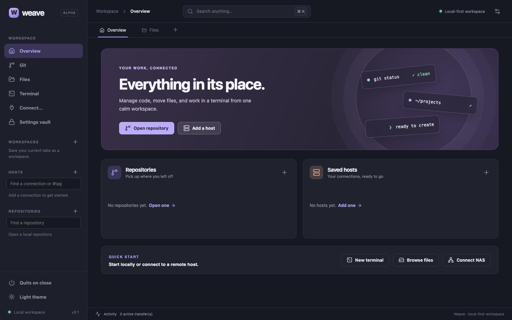

From here you can **Open repository** (a Git folder on your computer) or **Add a host** (a server). The **Quick start** row at the bottom opens a local terminal, the file browser, or a NAS connection.

## 2. Finding your way around

| Area | What it is |
| --- | --- |
| **Sidebar** | Pages (Overview, Git, Files, Terminal, Connect…, Settings vault), saved workspaces, your hosts grouped and tagged, and your repositories. Type in **Find a connection or #tag** to filter hosts. |
| **Tab bar** | Every open page, repository and terminal is a tab. **+** opens a new local terminal. |
| **Search anything (⌘K, or Ctrl+Shift+P on Windows and Linux)** | The command palette: every action, repository and host by name. |
| **Activity** (bottom left) | The transfer queue and history. |

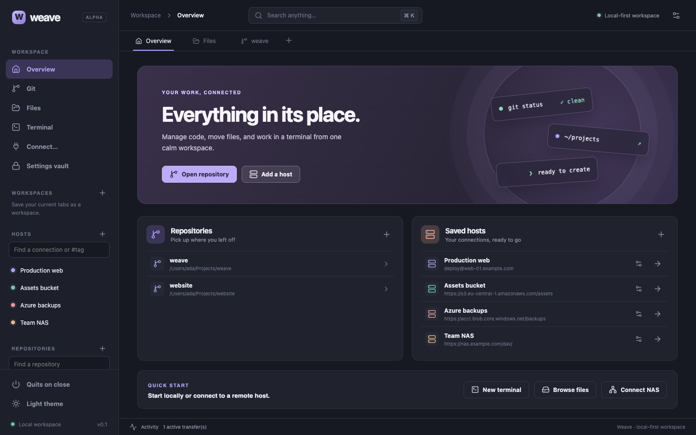

The command palette is the quickest way to anything. Press **⌘K**, type a few letters, press **Return**:

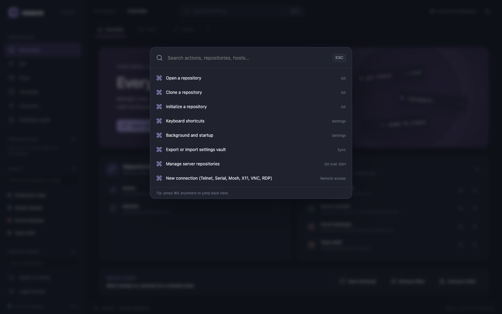

## 3. Saving connections

Click **Add a host** on Overview or **+** next to **Hosts** in the sidebar.

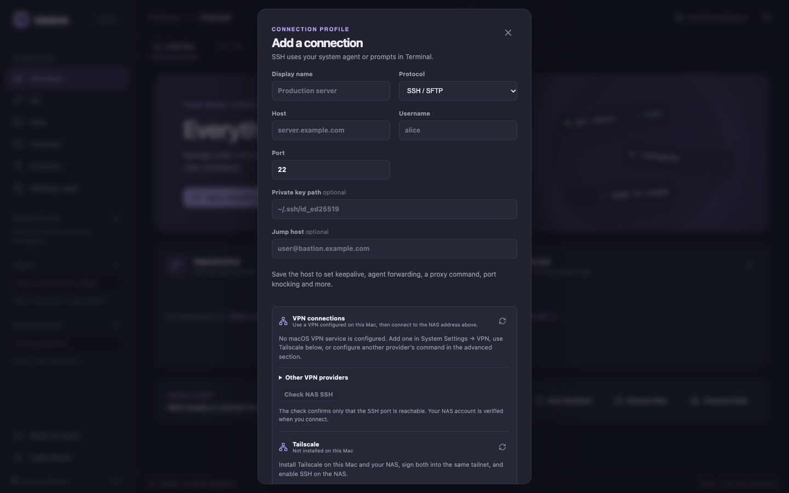

1. **Display name**: what the sidebar shows.
2. **Protocol**: choose one of these:
   - **SSH / SFTP**: terminals, file transfer, tunnels and Git over SSH. Enter the host, user name and port (22). Weave uses your SSH keys and agent, and `~/.ssh/config`. Add a **Private key path** to use a specific key and a **Jump host** (`user@bastion`) to go through a bastion.
   - **FTPS (explicit or implicit TLS)** and **FTP**. Prefer FTPS; plain FTP sends passwords unencrypted and Weave says so.
   - **WebDAV (HTTPS)**: enter the full address, for example `https://cloud.example.com/remote.php/dav/files/ada/`.
   - **S3-compatible storage**: choose a provider (Amazon S3, Cloudflare R2, Backblaze B2, Wasabi, DigitalOcean Spaces or custom/MinIO), the bucket and region, and an access key and secret, or pick an **AWS CLI profile**.
   - **Azure Blob Storage**: the container address (`https://account.blob.core.windows.net/container`) and either the account key or a SAS token.
   - **Dropbox, Google Drive, OneDrive**: enter your own app's client ID, then **Sign in** in the browser. See [Cloud drives](#cloud-drives).
3. **Password, key or token**: tick **Remember … in macOS Keychain** to keep it; otherwise Weave keeps it only until it quits. For SSH the password is optional: hosts with keys don't need one.

**Signing in to university clusters and other servers with passwords or two-factor codes:** when a server asks for a password, a Duo/OTP code, or to trust a new host key, Weave shows the question in a dialog, the same way FileZilla does. A saved password is filled in for you. For Duo, type the passcode, or the option number (for example `1` for a push). The sign-in then stays open for five minutes, so one code covers browsing and copying.
4. Click **Save**.

### Editing a saved host

Click the sliders icon next to a host on Overview to edit it. After the first save the editor also offers:

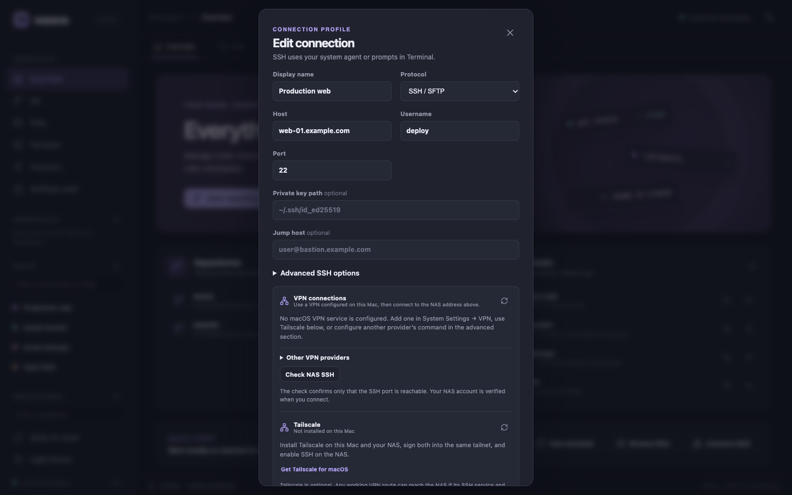

- **Advanced SSH options**: keepalive, agent forwarding, compression, a proxy command, environment variables, a command to run after connecting, and a port-knock sequence.
- **VPN connections**: start or stop VPNs set up in your system, **Tailscale**, or another VPN's command-line tool before you connect.
- **Network tools**: ping, traceroute, a port check and Wake-on-LAN.
- **SSH keys**: list your keys, generate an Ed25519 key, and install it on the host (`ssh-copy-id`).
- **Tunnels**: local, remote and SOCKS forwards, optionally started whenever Weave starts.
- **Certificate pins** (FTPS and WebDAV): **Read from server** shows the server's certificate fingerprint, and you can require up to three. You can also present a **client certificate** from a file or your Keychain.
- **Known SSH hosts**: see the fingerprints OpenSSH has accepted, and forget one.

### Deleting a host

Open the host's editor and click **Delete host**. Weave asks once, then removes the host together with everything it kept for it: the saved password and sign-ins in the Keychain, its settings, tunnels, sync jobs, queued transfers, terminal history, host-specific snippets, scripts and bookmarks, and its open shared SSH connection. Files on the server are not touched.

### Importing hosts

The bottom of **Add a connection** has import links: **Import hosts from ~/.ssh/config**, **Import FileZilla sites**, **Import WinSCP, PuTTY, MobaXterm or Cyberduck** (this also reads SecureCRT and Termius exports), and **Import from settings vault**. Passwords are never imported; enter them once when you connect.

### Groups and tags

In the host editor, give a host a **Group** (for example *Production*) and **Tags**. The sidebar groups hosts, and `#tag` in the filter shows only tagged hosts.

## 4. Terminal

Open a local terminal with **+** in the tab bar or **⌘T**. Click the arrow next to an SSH host to open it in a terminal.

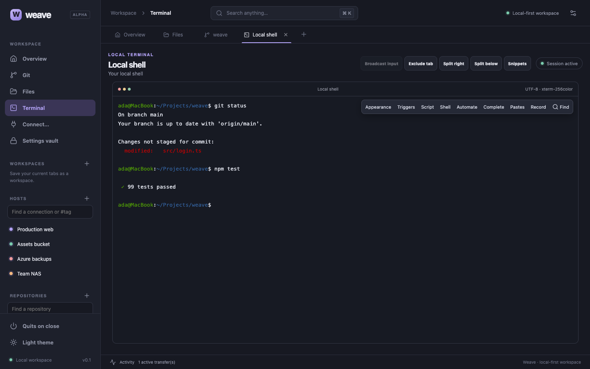

**Across the top of the page:**

- **Split right / Split below** show two terminals side by side.
- **Broadcast input** types into every connected tab at once (it asks first). **Exclude tab** keeps one tab out of the broadcast.
- **Snippets**: saved commands, with `{{variables}}` Weave asks for. Pinned snippets appear as buttons above the terminal.

**The bar inside the terminal:**

| Button | What it does |
| --- | --- |
| **Appearance** | Font size, theme, scrollback, cursor, and the notification for long commands. |
| **Triggers** | When output contains a phrase or pattern: alert, notify, highlight the line, or type a reply. |
| **Script** | Run a short shell script on this computer or the host and see its output and exit code. |
| **Shell** | Install shell integration (zsh, bash, fish): current-folder tracking, ⌘↑/⌘↓ to jump between prompts, failed commands marked. |
| **Automate** | Expect-style steps, for example: wait for `login:`, send a user name. |
| **Complete** (⌃Space) | Commands from your history and from the host's shell. |
| **Pastes** | Text you pasted recently. Kept in memory only, never on disk. |
| **Record** | Save the session as an asciicast `.cast` or a plain-text log. |
| **Find** (⌘F) | Search this terminal's scrollback. ⌘⌥F searches **all** terminal tabs. |

**Pasting several lines** asks first, because each line runs as it arrives. **Paste as one line** joins them instead:

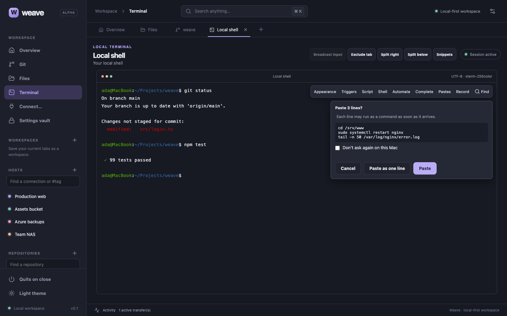

**More terminal features:**

- **⌘+ / ⌘− / ⌘0** zoom this terminal.
- **⌘-click** a file path in the output to open it: folders open in Files, local files in their default app.
- **Fill saved password** appears at prompts such as `Password:` or `[sudo] password for`. It types the connection's Keychain password directly into the session.
- **Pictures**: `imgcat` (iTerm2 image protocol) and Sixel images display inline.
- **sz and rz (ZMODEM)**: run `sz file` on the host and the file is saved to your Downloads folder without replacing anything. Run `rz` and Weave asks which files to send. Files up to 512 MB each; the host needs `lrzsz` installed.
- **Long commands**: with shell integration installed, Weave notifies you when a command that ran over 10 seconds finishes while you are in another app.

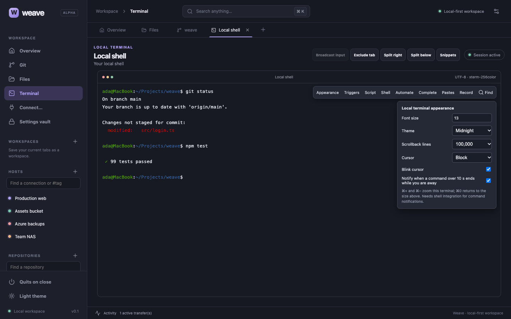

## 5. Other kinds of connection

**Connect…** in the sidebar opens Telnet, serial, Mosh, X11, VNC and RDP connections.

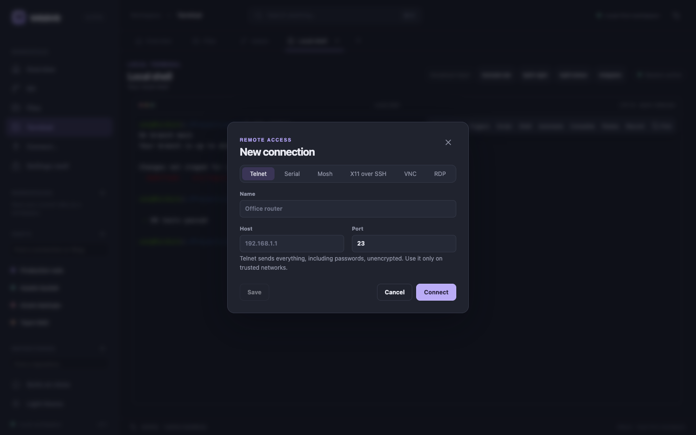

- **Telnet**: built in, for routers and switches. It is unencrypted, so use it only on trusted networks.
- **Serial**: choose the `/dev/cu.*` device and the baud rate (300 to 921,600).
- **Mosh** and **X11 over SSH** reuse a saved SSH host. They need `brew install mosh` and XQuartz.
- **VNC** shows the remote screen inside Weave, optionally through an SSH host. It can also open in macOS Screen Sharing.
- **RDP** opens Microsoft's Windows App.

Click **Save** to keep the connection in the sidebar, or **Connect** to open it now.

## 6. Files

**Files** shows two panes. Each pane can be this computer or any saved connection; pick it from the menu at the top of the pane.

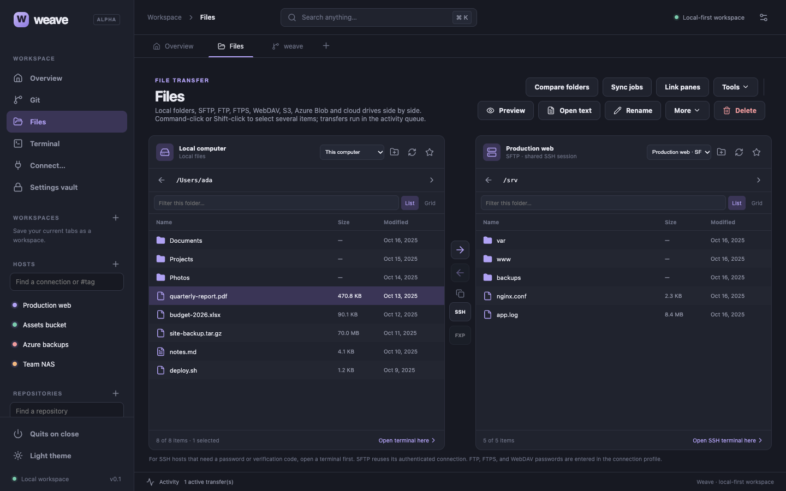

### Moving around and selecting

- Double-click a folder to open it. Use the arrows for back and forward, and type in **Filter this folder…** to narrow the list.
- Click to select. ⌘-click adds items, ⇧-click selects a range.
- **List / Grid** changes the view. The star bookmarks a folder.
- **Link panes** makes both panes follow each other when the folder structure matches.

### Copying

- Use the **→** and **←** buttons between the panes, or drag from one pane to the other or from your file manager.
- **SSH** copies with SCP or rsync, including directly between two SSH hosts. **FXP** copies directly between two FTP servers.
- Every copy joins the transfer queue in **Activity**. It can be paused, resumed, retried, reordered and speed-limited, and finished copies are checked with SHA-256.

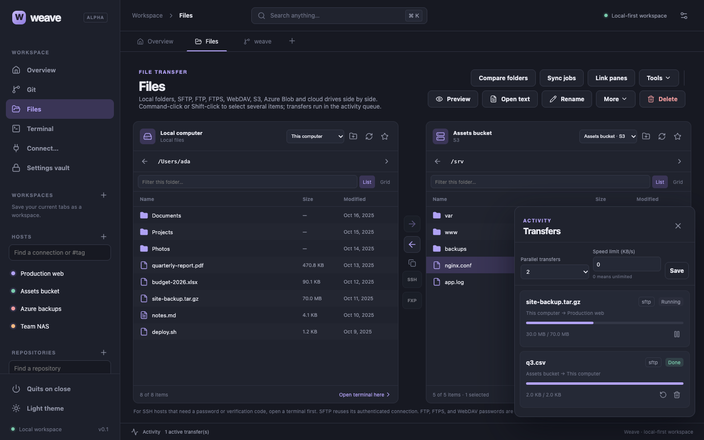

### The More menu

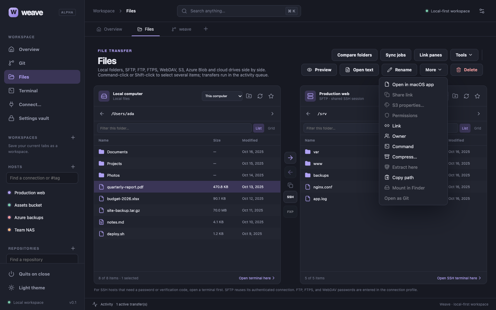

| Item | What it does |
| --- | --- |
| **Open in default app** | Edit a remote file in any app on your computer. Weave uploads it when you save, after checking nobody changed it. |
| **Share link** | A time-limited download link (S3), or a public link (Nextcloud/ownCloud). |
| **S3 properties…** | Content type, caching, storage class, metadata and tags. |
| **Permissions / Owner / Link** | chmod, chown and symbolic links (this computer and SSH). |
| **Command** | Run your own command on the selected files. |
| **Compress… / Extract here** | zip, tar.gz, tar.bz2, tar.xz or tar, on this computer and SSH hosts. Extracting always creates a new folder. |
| **Copy path** | Full paths; SSH paths are copied as `user@host:path`. |
| **Mount in Finder** | Show a WebDAV or FTP connection as a drive in Finder (File Explorer on Windows, the file manager on Linux). The system asks for the password. |
| **Open as Git** | Open a local folder as a repository. |

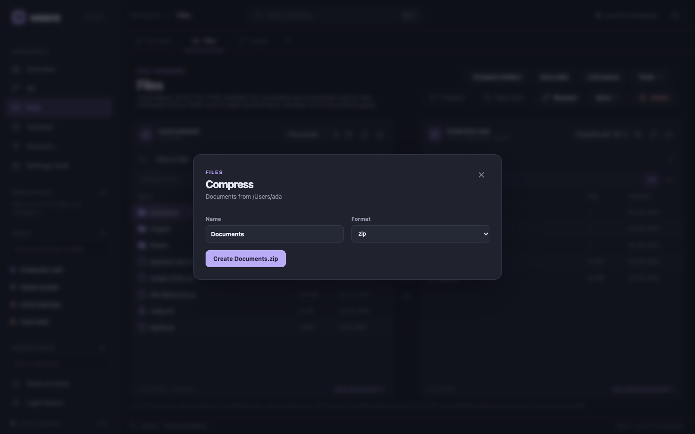

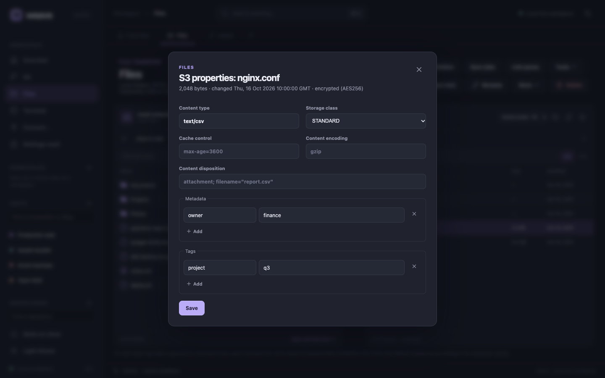

### Compare and sync

**Compare folders** compares the two panes and shows what would be copied before anything happens. Mirror modes also list files that exist only at the destination, so you can confirm deleting them as a separate step.

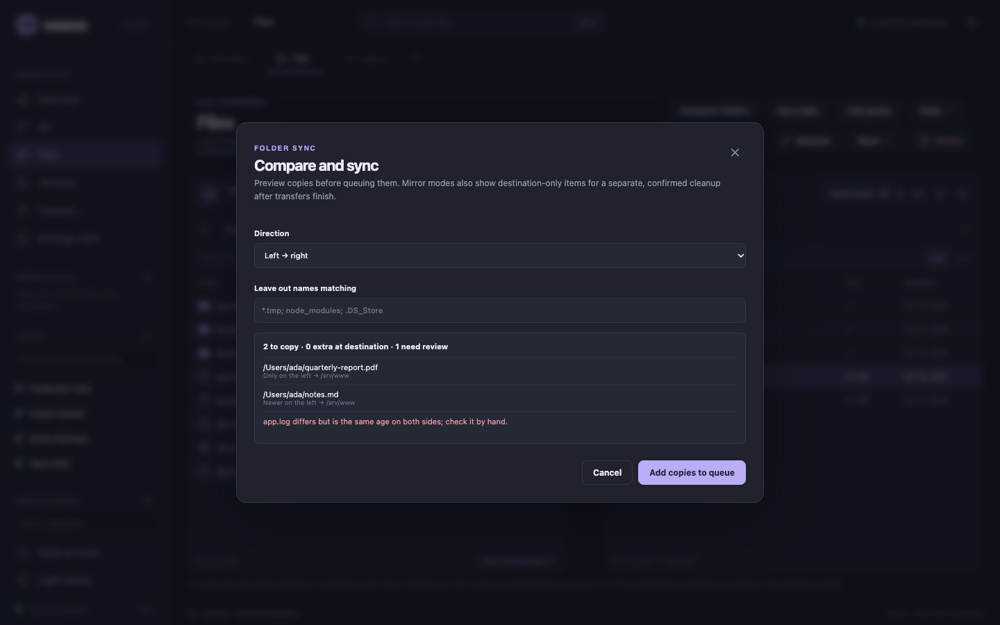

**Sync jobs** saves a comparison to run every 15 minutes to 7 days, or whenever the source folder changes.

### Tools menu

- **Import copy plan**: queue up to 200 copies from a JSON file.
- **Cryptomator vault**: open, create and edit Cryptomator vaults (formats 7 and 8).
- **Network share…**: mount SMB and NFS shares.
- **Find…** (⌘⇧F): search for files by name.
- **Script…**: WinSCP-style file scripts (`open`, `get`, `put`, `sync`…).
- **Serve…**: share a folder over TFTP or read-only HTTP.

### Cloud drives

Dropbox, Google Drive and OneDrive need an app registered under your own account with that provider. Weave cannot ship a shared one. In the connection editor, Weave shows the redirect address to register (`http://localhost:53682/`). Paste your app's client ID, click **Sign in**, and approve access in the browser.

## 7. Git

Open a repository with **Open repository**, clone one with **Clone a repository** in the palette, or initialize a new one.

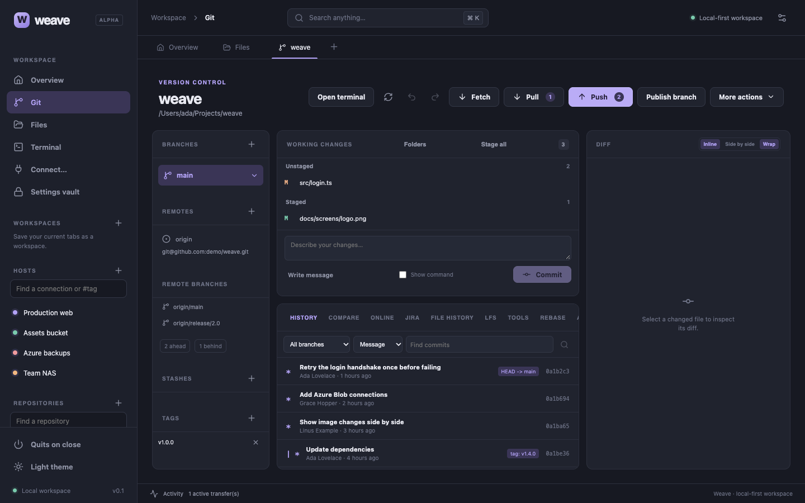

### Committing

1. **Working changes** lists changed files. Click one to see its diff on the right.
2. Stage a whole file, one **section** (hunk), or a single **line** with the **Stage** buttons in the diff.
3. Write a message, or click **Write message** to have Claude draft one from the staged changes (needs your own Anthropic API key, kept in Keychain).
4. Click **Commit**. Then **Push** (the badge shows how many commits are waiting) or **Publish branch** for a new branch.

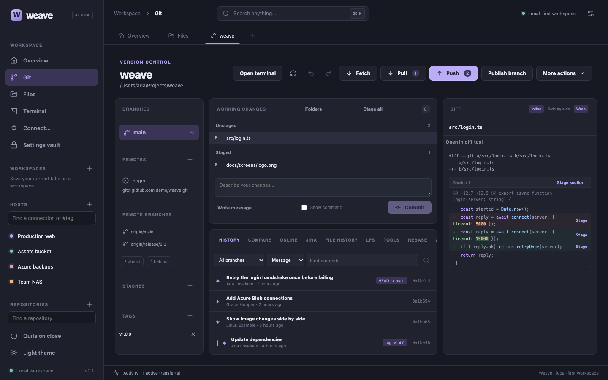

Diffs have syntax highlighting, changed words marked, **Inline / Side by side** views and **Wrap**. Changed images show before and after.

### History and commit details

Click any commit in **History** to see its message, author, parents and changed files, with a diff for each file. From there: **Copy ID**, **Branch here…**, **Cherry-pick**, **Revert**, **Check out**, or **Explain** (Claude describes the commit).

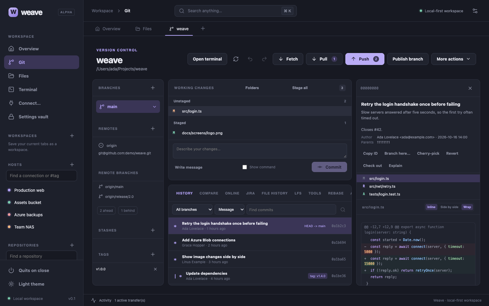

Search history by message, author or changed content, and filter by branch.

### Compare

The **Compare** tab compares two branches, tags or commits, pull-request style or directly. It shows ahead/behind counts and a diff per file, and **Write pull request description** drafts the text. **Files and folders** compares any two files or folders on your Mac.

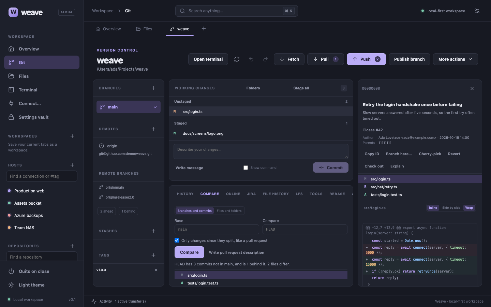

### More actions

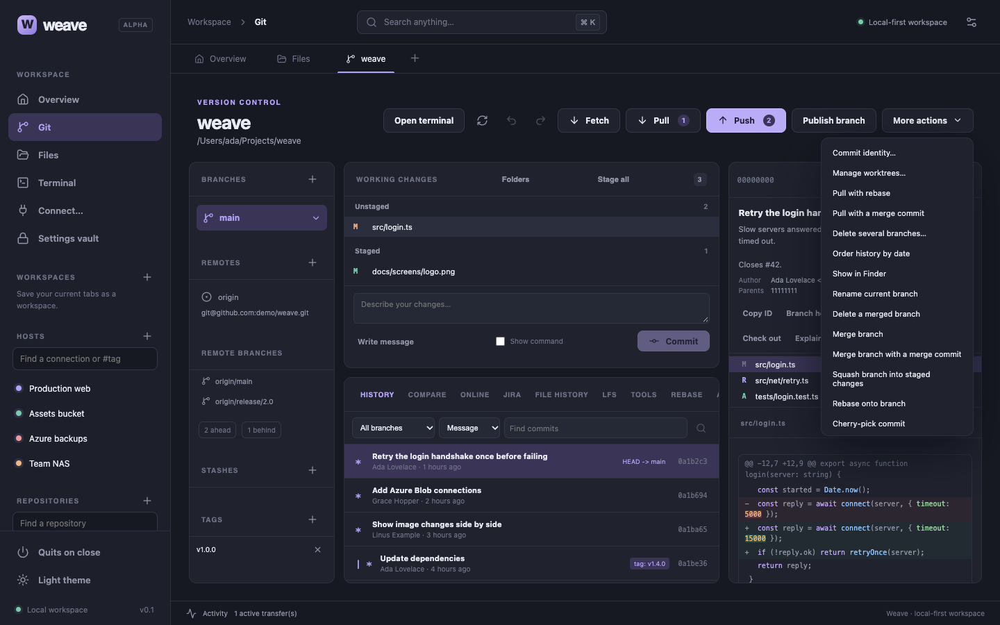

- **Pull with rebase / Pull with a merge commit** (plain **Pull** only fast-forwards).
- **Merge branch**, **Merge branch with a merge commit**, **Squash branch into staged changes**, **Rebase onto branch**.
- **Delete several branches…**: unmerged branches are kept unless you say otherwise, and every deletion can be undone.
- **Order history by date / Group history by branch**.
- **Manage worktrees…**, **Commit identity…**, **Show in Finder**, tags, remotes and resets.
- **Undo / Redo** (the curved arrows in the toolbar) step back and forward through your recent Git actions.

### The other tabs

| Tab | What is in it |
| --- | --- |
| **Online** | GitHub, GitLab, Bitbucket and Azure DevOps: pull requests, reviews, comments, CI, issues, and creating repositories. |
| **Jira** | Search, create and move issues. |
| **File history** | One file's history across renames, blame (with search), and a line range's history. |
| **LFS** | Track patterns, download files, locks, and migrating history to LFS. |
| **Tools** | Submodules, sparse checkout, commit signing (SSH or OpenPGP), Gitflow, and restoring branch history. |
| **Rebase** | Reorder, reword, squash, fix up and drop commits with the arrow buttons, or edit the full plan for branches with merges. |
| **Advanced** | External diff/merge tools, bisect, patches, cleaning untracked files, stash options, annotated tags, notes, subtrees, custom Git commands, and deleted branches. |

### Repositories on your own server

**Manage server repositories** in the palette lists the bare repositories in a folder on an SSH host. From there you can create them, set the default branch, block force pushes, edit hooks, clone, or delete one (you type its name to confirm). It also manages Gitea/Forgejo repositories and Gitolite access rules.

### Cloning

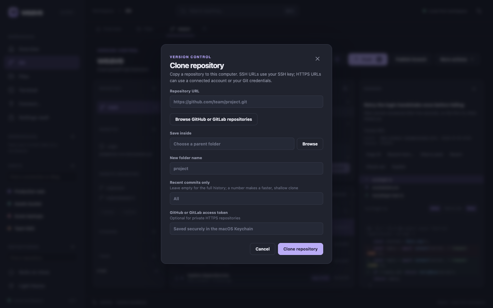

Paste the address, choose a folder and name, and optionally a token for a private HTTPS repository. Weave stores the token in Keychain and uses it for later pulls and pushes. **Recent commits only** makes a faster, shallow clone.

## 8. Settings, sync and security

### Background, startup and lock

The command palette's **Background and startup**:

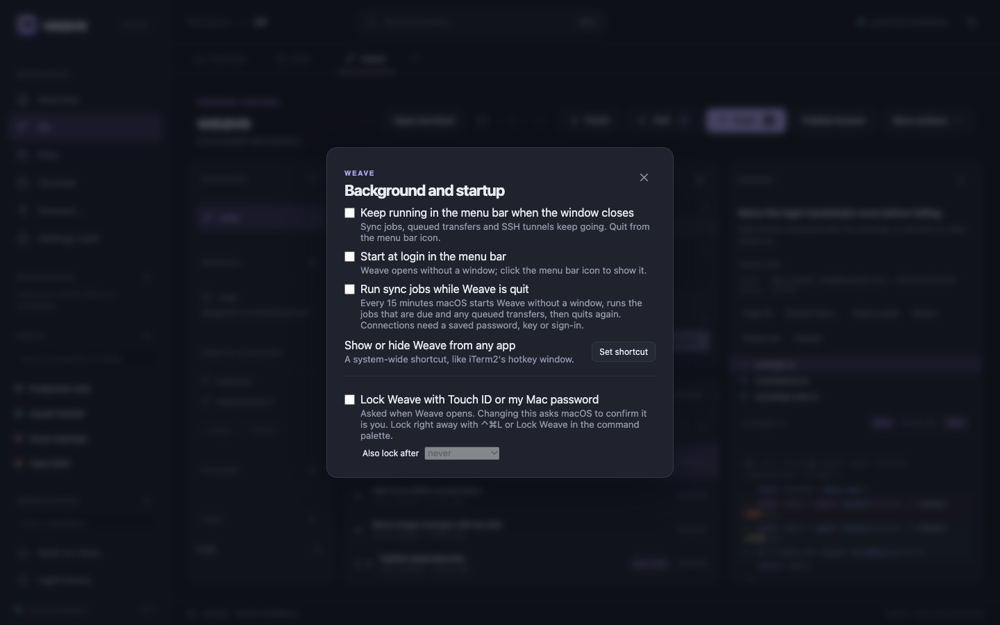

- **Keep running in the menu bar** so transfers, sync jobs and tunnels continue with the window closed.
- **Start at login** and **Run sync jobs while Weave is quit**.
- **Show or hide Weave from any app** with a system-wide shortcut.
- **Lock Weave with Touch ID or my Mac password**, when Weave opens and after a chosen idle time. Lock right away with **⌃⌘L** (Ctrl+Alt+L on Windows and Linux). On Windows and Linux you choose a Weave lock password instead of Touch ID. Changing these settings asks macOS to confirm it is you.

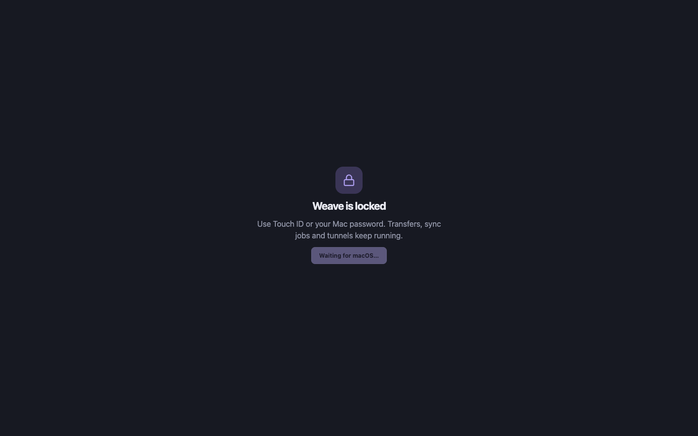

### Settings vault and team vault

**Settings vault** exports hosts, workspaces, snippets, scripts, triggers and appearance to an encrypted `.weavevault` file protected by a passphrase you choose. Import it on another Mac. Passwords, keys and tokens are never included.

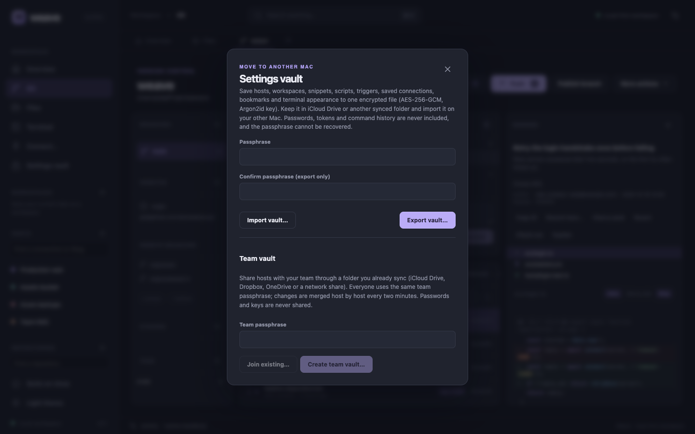

A **team vault** shares chosen hosts with teammates through an encrypted file in a folder you already sync (iCloud Drive, Dropbox…). Weave merges changes every two minutes.

### Workspaces

Click **+** next to **Workspaces** to save the open tabs, the repository and both file panes. Click the workspace later to restore them.

## 9. Keyboard shortcuts

Open **Keyboard shortcuts** from the palette to see or change any of them.

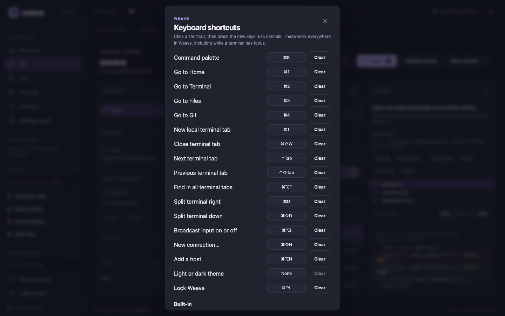

| macOS | Windows and Linux | Action |
| --- | --- | --- |
| ⌘K | Ctrl+Shift+P | Command palette |
| ⌘1 to ⌘4 | Ctrl+Shift+1 to Ctrl+Shift+4 | Overview, Terminal, Files, Git |
| ⌘T / ⇧⌘W | Ctrl+Shift+T / Ctrl+Shift+W | New terminal tab / close it |
| ⌃Tab / ⌃⇧Tab | Ctrl+Tab / Ctrl+Shift+Tab | Next / previous terminal tab |
| ⌘D / ⇧⌘D | Ctrl+Shift+D / Ctrl+Alt+Shift+D | Split right / below |
| ⌘F / ⌘⌥F | Ctrl+Shift+F / Ctrl+Alt+Shift+F | Find in this terminal / in all terminal tabs |
| ⌘C / ⌘V | Ctrl+Shift+C / Ctrl+Shift+V | Copy and paste in a terminal |
| ⌘+ ⌘− ⌘0 | Ctrl++ Ctrl+− Ctrl+0 | Terminal zoom |
| ⌃Space | Ctrl+Space | Command completion |
| ⌘↑ / ⌘↓ | Ctrl+Shift+↑ / Ctrl+Shift+↓ | Previous / next prompt |
| ⌘⌥I | Ctrl+Shift+I | Broadcast input on or off |
| ⇧⌘N / ⌘⌥N | Ctrl+Shift+N / Ctrl+Alt+N | New connection / add a host |
| ⌃⌘L | Ctrl+Alt+L | Lock Weave |
| ⌘Y / ⌘⇧F | Ctrl+Y / Ctrl+Shift+F | Preview / find files (Files) |

On Windows and Linux, plain Ctrl+C, Ctrl+D and the other Ctrl keys go to the shell, as they do in other terminal apps.

## 10. Where Weave keeps your data

| What | Where |
| --- | --- |
| Passwords, secrets, tokens, sign-ins, API keys | The system credential store, under the service `app.weave.desktop`: Keychain on macOS, Credential Manager on Windows, Secret Service (such as GNOME Keyring) on Linux |
| Hosts, transfers, sync jobs, settings | `weave.db` in Weave's data folder |
| Snippets, triggers, appearance, keyboard shortcuts | The app's local web storage on this computer |
| Exported client certificates | `client-certificates` in Weave's data folder (readable only by you) |
| External editing copies | Weave's data folder, until you discard them |

Weave's data folder is `~/Library/Application Support/app.weave.desktop` on macOS, `%APPDATA%\app.weave.desktop` on Windows and `~/.local/share/app.weave.desktop` on Linux.

Weave sends nothing anywhere except to the servers you connect to, and to Anthropic only when you click an AI button.

## 11. Troubleshooting

- **"This service allows sftp connections only"**: the server allows file transfer but no terminal (common on university clusters). Weave notices this, closes the terminal and opens the host in **Files**, and it opens there from then on. You can also tick **File transfer only (SFTP)** in the host editor.
- **"refused the sign-in" / Permission denied**: check that the user name matches the server exactly. User names are case-sensitive (`ada` is not `Ada`). Then check the password or code.
- **"Host key verification failed"**: connect once in a terminal tab and confirm the fingerprint, or forget the old entry under **Known SSH hosts** in the host editor.
- **SFTP asks for a password or code every time**: Weave keeps a sign-in open for five minutes after the last use. Save the password in the host editor (tick **Remember**) and only the verification code is asked.
- **"This connection needs a password"**: edit the host and enter it, ticking **Remember**.
- **A server's certificate is not trusted**: check it with **Read from server** in the host editor before pinning its fingerprint.
- **Cloud drive sign-in fails**: check that the redirect address registered with your provider is exactly `http://localhost:53682/`.
- **"The server listed an unsafe name"**: a server listed a file called `..` or with a slash in its name. Weave refuses to copy that folder so nothing is written outside your destination.
